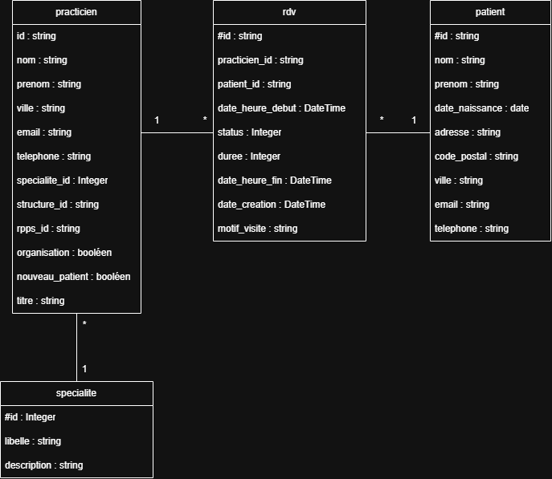

# TD1.1 — Partie 1 — Exercice 1 : analyse de l’architecture de l’application JIRA

## 1. Analyse de l’architecture de l’application

L’application JIRA utilise une architecture hexagonale. Elle sépare le noyau applicatif métier des éléments techniques, comme les requêtes HTTP et la base de données.

### Quels sont les adaptateurs d’entrée et leur namespace ?

Les adaptateurs d’entrée sont les actions HTTP. Ils reçoivent une requête, contrôlent ses données, appellent un service applicatif, puis construisent la réponse HTTP. Les actions utilisent le namespace `jira\adapters\controllers\actions`.

### Quels sont les adaptateurs de sortie et leur namespace ?

Les adaptateurs de sortie sont les repositories PostgreSQL. Ils traduisent les demandes du noyau applicatif en requêtes PDO et reconstruisent les entités à partir des données obtenues. Ils utilisent le namespace `jira\adapters\persistence`.

### Quels sont les services applicatifs métier et leur namespace ?

Les services applicatifs coordonnent les cas d’utilisation. Ils récupèrent les entités au moyen des ports de sortie, appellent leurs méthodes métier et demandent leur sauvegarde. Ils utilisent le namespace `jira\application\usecases`.

### Quel est le domaine et quels namespaces utilise-t-il ?

Le domaine constitue le cœur de l’application. Il contient les entités et leurs règles de gestion, sans dépendre du framework HTTP ou de la base de données. Les entités utilisent le namespace `jira\domain\entities` et les exceptions métier le namespace `jira\domain\exceptions`.

## 2. Diagramme de classes du domaine

### Quelles sont les entités, leurs propriétés et leurs méthodes ?

### UserStory

Propriétés :

- `id` : identifiant de la user story ;
- `title` : titre ;
- `description` : description ;
- `status` : statut actuel ;
- `owner` : responsable de la user story.

Méthodes métier :

- `assignTo()` : attribue la user story à un responsable ;
- `start()` : fait passer son statut de `TODO` à `WIP` ;
- `finish()` : fait passer son statut de `WIP` à `DONE` ;
- `close()` : fait passer son statut de `DONE` à `CLOSED` ;
- `updateTitle()` : modifie le titre ;
- `updateDescription()` : modifie la description ;
- `changeStatusTo()` : change le statut après vérification ;
- `isStatusChangeAllowed()` : vérifie qu’un changement de statut est autorisé ;
- `getId()`, `getTitle()`, `getDescription()`, `getOwner()` et `getStatus()` : retournent les propriétés de la user story.

### Owner

Propriétés :

- `userId` : identifiant du responsable ;
- `username` : nom du responsable.

Méthodes :

- `getUserId()` : retourne l’identifiant ;
- `getUsername()` : retourne le nom.

### User

Propriétés :

- `id` : identifiant de l’utilisateur ;
- `username` : nom de l’utilisateur ;
- `passwordHash` : empreinte du mot de passe.

Méthodes :

- `getId()` : retourne l’identifiant ;
- `getUsername()` et `setUsername()` : lisent et modifient le nom ;
- `getPasswordHash()` et `setPasswordHash()` : lisent et modifient l’empreinte du mot de passe.

### UserStoryStatus

L’énumération `UserStoryStatus` définit les quatre statuts possibles : `TODO`, `WIP`, `DONE` et `CLOSED`.

### Relations

Une `UserStory` possède un `Owner` et un `UserStoryStatus`. Elle utilise `StatusChangeNotAllowedException` lorsqu’une transition de statut est interdite.

## 3. Ports d’entrée et services qui les implantent

Le projet contient un seul port d’entrée : l’interface `UserStoryServiceInterface`, située dans le namespace `jira\application\ports\api`. Elle définit les opérations que les adaptateurs d’entrée peuvent demander au noyau : créer, consulter, modifier, supprimer et faire évoluer l’état d’une user story.

Cette interface est implantée par le service applicatif `UserStoryService`, situé dans le namespace `jira\application\usecases`. Les actions dépendent ainsi de l’interface et non directement de la classe concrète.

## 4. Ports de sortie et adaptateurs qui les implantent

Les ports de sortie sont situés dans le namespace `jira\application\ports\spi`. Ils définissent les opérations de persistance dont le noyau a besoin sans imposer de technologie de stockage.

- `UserStoryRepository` est implanté par `PgUserStoryRepository` ;
- `OwnerRepository` est implanté par `PgOwnerRepository`.

Ces deux adaptateurs appartiennent au namespace `jira\adapters\persistence`. `PgUserStoryRepository` recherche, enregistre et supprime les user stories. `PgOwnerRepository` recherche un responsable. Le préfixe `Pg` indique que ces implantations utilisent PostgreSQL.

## 5. Inversion de dépendances entre la persistance et le noyau métier

Sans inversion de dépendances, `UserStoryService` devrait appeler directement PDO ou les repositories PostgreSQL. Le noyau métier serait alors lié à la base de données.

Dans le projet, l’inversion est réalisée grâce aux interfaces `UserStoryRepository` et `OwnerRepository`, qui sont définies dans le noyau applicatif.

Le service `UserStoryService` dépend de ces interfaces et non directement des classes utilisant PostgreSQL. La classe `ContainerConfig` associe ensuite `UserStoryRepository` à `PgUserStoryRepository` et `OwnerRepository` à `PgOwnerRepository`.

Les implantations sont fournies au service par injection de dépendances. Le sens de la dépendance est donc inversé : les adaptateurs PostgreSQL dépendent des interfaces du noyau, alors que le noyau ne dépend ni de PDO ni de PostgreSQL.

## 6. Classes du noyau applicatif métier et leurs dépendances

### Quelles classes sont définies dans la couche application ?

Les classes et interfaces définies sont :

- `UserStoryService` : exécute les cas d’utilisation ;
- `UserStoryServiceInterface` : définit le port d’entrée ;
- `UserStoryRepository` : définit le port de sortie des user stories ;
- `OwnerRepository` : définit le port de sortie des responsables ;
- `CreateUserStoryDTO` : transporte les données de création ;
- `UpdateUserStoryDTO` : transporte les données de modification ;
- `UserStoryOutputDTO` : transporte les données retournées ;
- `CreateUserStoryValidator` : valide les données de création ;
- `ValidationException` : représente une erreur de validation.

### Quelles classes sont utilisées par la couche application ?

- `UserStoryService` implémente `UserStoryServiceInterface` ;
- `UserStoryService` utilise `UserStoryRepository`, `OwnerRepository` et `CreateUserStoryValidator` ;
- il utilise aussi `UserStory`, `UserStoryStatus`, `CreateUserStoryDTO`, `UpdateUserStoryDTO` et `UserStoryOutputDTO` ;
- `CreateUserStoryValidator` utilise `OwnerRepository` pour vérifier l’existence du responsable ;
- `UserStoryOutputDTO` utilise `UserStory` pour transformer une entité en données de sortie ;
- `CreateUserStoryDTO` et `UpdateUserStoryDTO` utilisent `ValidationException` ;
- `UserStoryService` utilise la classe externe `Ramsey\Uuid\Uuid` pour générer les identifiants.

### Quelles classes sont définies dans le domaine ?

Les classes définies sont :

- `UserStory` ;
- `Owner` ;
- `User` ;
- `UserStoryStatus` ;
- `StatusChangeNotAllowedException` ;
- `UserStoryNotFoundException` ;
- `PersistenceException`.

### Quelles classes sont utilisées par le domaine ?

- `UserStory` dépend de `UserStoryStatus` pour gérer son état ;
- `UserStory` dépend de `Owner`, car elle est attribuée à un responsable ;
- `UserStory` utilise `StatusChangeNotAllowedException` lorsqu’une transition est interdite ;
- `User` utilise la classe externe `Ramsey\Uuid\Uuid` ;
- `PersistenceException` hérite de `RuntimeException` ;
- `StatusChangeNotAllowedException` et `UserStoryNotFoundException` héritent de `Exception`.

## 7. Classes des adaptateurs d’entrée et de sortie et leurs dépendances

### Quelles classes sont définies dans les adaptateurs d’entrée ?

Les actions définies sont :

- `AbstractAction` ;
- `CreateUserStoryAction` ;
- `GetAllUserStoriesAction` ;
- `GetUserStoryByIdAction` ;
- `PatchUserStoryAction` ;
- `DeleteUserStoryAction` ;
- `StartUserStoryAction` ;
- `FinishUserStoryAction` ;
- `CloseUserStoryAction` ;
- `ChangeStatusAction`.

Toutes les actions concrètes héritent de `AbstractAction`. Elles utilisent les interfaces HTTP de PSR, les exceptions HTTP de Slim et le port d’entrée `UserStoryServiceInterface`.

### Quelles classes sont utilisées par les adaptateurs d’entrée ?

- `AbstractAction` utilise `JsonRenderer` pour produire les réponses JSON ;
- `CreateUserStoryAction` utilise `CreateUserStoryDTO`, `CreateUserStoryValidator`, `ValidationException` et `PersistenceException` ;
- `PatchUserStoryAction` utilise `UpdateUserStoryDTO`, `ValidationException` et `UserStoryNotFoundException` ;
- `GetUserStoryByIdAction` et `DeleteUserStoryAction` utilisent `UserStoryNotFoundException` ;
- `StartUserStoryAction`, `FinishUserStoryAction` et `CloseUserStoryAction` utilisent `UserStoryNotFoundException` et `StatusChangeNotAllowedException` ;
- `ChangeStatusAction` utilise aussi `UserStoryStatus` ;
- `GetAllUserStoriesAction` utilise `UserStoryOutputDTO`.

### Quelles classes sont définies dans les adaptateurs de sortie ?

Les classes définies sont :

- `PgUserStoryRepository` ;
- `PgOwnerRepository` ;
- `RepositoryDatabaseErrorException`.

### Quelles classes sont utilisées par les adaptateurs de sortie ?

- `PgUserStoryRepository` implémente `UserStoryRepository` ;
- il utilise PDO pour accéder à PostgreSQL ;
- il transforme les données de la base en objets `UserStory`, `Owner` et `UserStoryStatus` ;
- il utilise `Uuid` pour vérifier les identifiants ;
- il peut produire `UserStoryNotFoundException` ou `RepositoryDatabaseErrorException` ;
- `PgOwnerRepository` implémente `OwnerRepository` ;
- il utilise PDO et construit des objets `Owner` ;
- `RepositoryDatabaseErrorException` hérite de `PersistenceException`.

## 8. Examen des tests du projet

### Qu’est-ce qui est testé dans le domaine ?

Les tests de `UserStoryDomainTest` vérifient les règles de changement de statut d’une user story :

- une nouvelle user story possède le statut `TODO` ;
- le passage de `TODO` vers `WIP` est accepté ;
- le passage de `WIP` vers `DONE` est accepté ;
- les passages directs de `TODO` vers `DONE` ou `CLOSED` sont refusés ;
- le passage de `WIP` vers `CLOSED` est refusé ;
- les retours de `DONE` vers `WIP` et de `CLOSED` vers `DONE` sont refusés.

Lorsqu’une transition est interdite, le test vérifie qu’une `StatusChangeNotAllowedException` est déclenchée.

### Comment les fonctionnalités nécessitant des données persistantes sont-elles testées ?

Les tests n’utilisent pas les données de la véritable base PostgreSQL. Ils emploient deux fausses implémentations qui stockent les données dans des tableaux en mémoire :

- `InMemoryUserStoryRepository` implémente `UserStoryRepository` ;
- `InMemoryOwnerRepository` implémente `OwnerRepository`.

Les tests ajoutent leurs propres objets dans ces repositories avant d’exécuter les fonctionnalités. Les données sont temporaires, indépendantes de la base réelle et recréées pour les tests. Cela permet de tester rapidement les services et les actions sans connexion à PostgreSQL.

