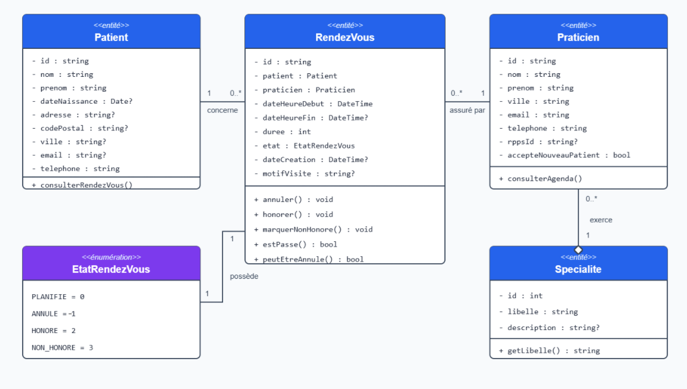

# TD1.1 — Partie 1 — Exercice 2 : analyse et architecture du projet Toubilib

## 1. Diagramme de classes du domaine métier

Le domaine de Toubilib est principalement composé des entités `Patient`, `Praticien`, `Specialite` et `RendezVous`. L’énumération `EtatRendezVous` limite l’état d’un rendez-vous aux valeurs `PLANIFIE`, `ANNULE`, `HONORE` et `NON_HONORE`.

Les méthodes qui modifient l’état, comme `annuler()`, appartiennent à l’entité `RendezVous`, car elles doivent appliquer les règles du domaine avant d’autoriser une transition.



## 2. Fonctionnalité n°6 : annuler un rendez-vous

### Comment implanter cette fonctionnalité dans le domaine ?

L’annulation est une règle métier. Elle doit donc être implantée dans l’entité `RendezVous` sous la forme d’une méthode `annuler()`.

Cette méthode contrôle l’état et la date du rendez-vous avant de le modifier. Un rendez-vous ne peut être annulé que s’il n’est pas passé et si son état actuel autorise cette transition. Lorsque les conditions sont respectées, la méthode remplace son état par `ANNULE`. Dans le cas contraire, elle lève une exception métier et ne modifie pas l’entité.

Le service applicatif `ServiceRendezVous` ne porte pas directement cette règle. Il coordonne le cas d’utilisation selon l’enchaînement suivant :

1. recevoir l’identifiant du rendez-vous à annuler ;
2. obtenir l’entité `RendezVous` par l’intermédiaire du port de sortie ;
3. appeler la méthode métier `annuler()` sur cette entité ;
4. demander la sauvegarde de l’entité modifiée ;
5. retourner un `RendezVousDTO` contenant le résultat du cas d’utilisation.

### Quelles erreurs peuvent être détectées lors de l’exécution ?

Plusieurs erreurs peuvent apparaître pendant ce cas d’utilisation :

- l’identifiant du rendez-vous est absent ou mal formé ;
- aucun rendez-vous ne correspond à l’identifiant fourni ;
- le rendez-vous est déjà annulé ;
- l’état actuel du rendez-vous interdit son annulation, par exemple s’il est déjà terminé ;
- la date et l’heure du rendez-vous sont passées ;
- une erreur technique empêche la lecture ou la mise à jour dans la base de données.

Les erreurs concernant la date et l’état sont détectées par l’entité `RendezVous`, car elles correspondent à des règles métier. Si le repository ne trouve rien, il retourne `null`, puis le service déclenche une `RendezVousNotFoundException`. Les problèmes de lecture ou de sauvegarde sont des erreurs techniques provenant de l’adaptateur de persistance.

### Quel composant retrouve l’entité correspondant au rendez-vous à annuler ?

Le service applicatif `ServiceRendezVous` déclenche la recherche en appelant la méthode `findById()` du port de sortie `RendezVousRepositoryInterface`.

La recherche est concrètement effectuée par l’adaptateur de persistance `RendezVousRepository`. Celui-ci exécute une requête avec PDO, lit la ligne correspondante dans la table `rdv`, puis construit et retourne une entité `RendezVous`. Le service ne connaît donc ni PDO ni la structure de la base de données.

### Quel composant sauvegarde le rendez-vous après sa modification ?

Après l’annulation dans le domaine, `ServiceRendezVous` appelle la méthode `save()` du port `RendezVousRepositoryInterface`.

L’adaptateur `RendezVousRepository` implante cette méthode et exécute la requête SQL qui met à jour l’état du rendez-vous dans la base de données. Le service décide donc quand sauvegarder, tandis que l’adaptateur de persistance sait comment effectuer cette sauvegarde.

### Quel port d’entrée proposer ?

Le port d’entrée proposé est l’interface `ServiceRendezVousInterface`. Il expose aux adaptateurs d’entrée le cas d’utilisation d’annulation :

```php
interface ServiceRendezVousInterface
{
    public function annuler(string $id): RendezVousDTO;
}
```

Cette interface est implantée par la classe `ServiceRendezVous`.

Une action HTTP peut utiliser ce port sans connaître l’implantation du service. Elle lui transmet l’identifiant du rendez-vous et reçoit un `RendezVousDTO` en retour.

### Quel port de sortie proposer ?

Le port de sortie proposé est l’interface `RendezVousRepositoryInterface`. Il définit uniquement les deux opérations de persistance nécessaires au cas d’utilisation : retrouver le rendez-vous concerné et sauvegarder son nouvel état.

```php
interface RendezVousRepositoryInterface
{
    public function findById(string $id): ?RendezVous;

    public function save(RendezVous $rendezVous): void;
}
```

Cette interface appartient au noyau applicatif et est implantée par l’adaptateur de persistance `RendezVousRepository`. Ainsi, `ServiceRendezVous` dépend d’une abstraction définie par le métier, tandis que l’adaptateur utilise PDO pour traduire les appels `findById()` et `save()` en requêtes SQL.
